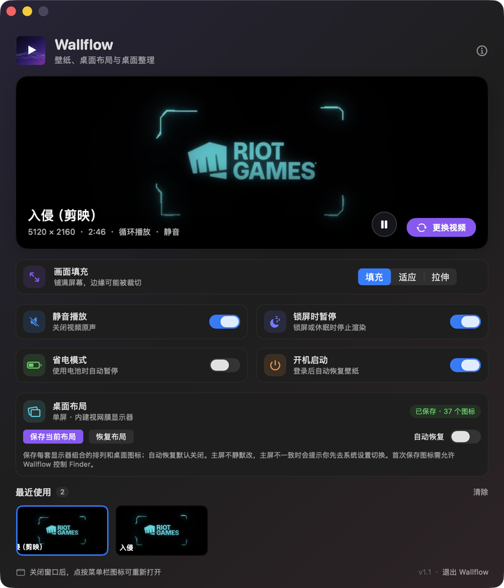
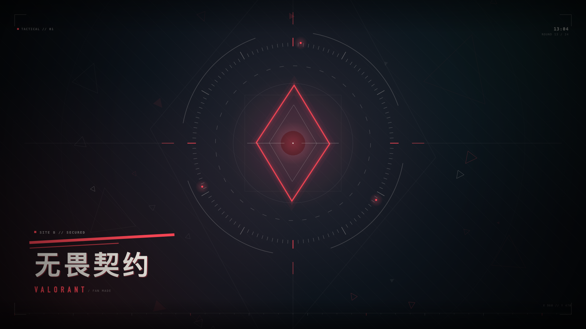

# Wallflow · 流光壁纸
一个原生 macOS 动态视频壁纸应用。选择一段视频，它就会在所有显示器的桌面图标下方循环播放，同时保持图标、Dock、右键菜单和窗口操作完全正常。

菜单栏应用，无 Dock 图标，空闲时占用很低（双屏 4K 实测约 6% CPU / 46 MB 内存）。

## 功能

- **视频壁纸**：支持 MP4 / MOV / M4V，使用 `AVPlayerLooper` 无缝循环播放。
- **多显示器**：每块屏幕独立铺满，外接屏热插拔自动适配。
- **桌面布局快照**：按「单屏 / 双屏」等显示器组合保存相对排列和 Finder 桌面图标位置；显示器变化后一键恢复，也可开启自动恢复（默认关闭）。
- **所有桌面空间**：切换 Space 后壁纸仍然在。
- **三种画面模式**：填充（裁切铺满）、适应（完整显示，留黑边）、拉伸。
- **暂停 / 静音**：随时从菜单栏或设置窗口控制。
- **最近使用**：带缩略图的最近视频列表，可一键切换。
- **锁屏 / 休眠自动暂停**：唤醒后继续播放，避免无意义渲染。
- **省电模式**：使用电池（或低电量模式）时自动暂停。
- **开机自动启动**：通过系统 `SMAppService` 注册，可在设置中开关。
- **内置示例壁纸**：首次启动即播放一段 12 秒的极光循环动画，无需先找素材。
- **拖放即用**：把视频拖进设置窗口的主视觉区域即可切换。

## 截图

**设置窗口**（深色半透明面板，左侧是视频拖放区，右侧是开关与下拉）：



**无畏契约风格示例壁纸**（`Tools/MakeValorantVideo.swift` 生成的原创战术霓虹循环，不含官方游戏画面）：



## 环境要求

- macOS 13 Ventura 或更高（已在 macOS 26 Tahoe 上测试）
- Apple Silicon 或 Intel（构建产物为通用二进制）
- 构建需要 Xcode 或 Command Line Tools

## 构建与运行

```bash
cd wallflow

# 仅构建，产物在 build/Wallflow.app
./build.sh

# 构建并安装到 /Applications，然后启动
./install.sh
```

也可以直接运行构建产物：

```bash
open build/Wallflow.app
```

制作可拖拽安装的 DMG：

```bash
./build.sh
./make_dmg.sh          # build/Wallflow-1.1.dmg
```

> 构建使用 ad-hoc 签名，没有经过 Apple 公证。在本机构建、本机运行不受影响；如果把 app 通过网络传到别的 Mac，首次打开需要右键 → 打开。

## 使用

1. 启动后，菜单栏会出现一个「屏幕 + 星光」图标。
2. 点按图标 → **选择视频…**，或点按 **设置…** 把视频拖进窗口。
3. 在设置窗口里调整填充方式、静音、锁屏暂停、省电和开机启动。
4. 关闭设置窗口不会退出应用；壁纸会继续播放。要从菜单栏重新打开设置即可。
5. **桌面布局**：在设置窗口的「桌面布局」卡片里点「保存当前布局」。接上或拔掉外接屏后，菜单栏会多出「恢复…桌面布局」；也可以打开「自动恢复」让它自己处理。
6. **退出 Wallflow** 后，桌面会恢复为系统壁纸。

菜单栏还提供：

- **在访达中显示视频**：定位当前壁纸文件
- **最近使用**：快速切换，支持清除记录
- **使用内置示例壁纸**：回到自带的极光动画
- **暂停壁纸 / 静音播放**
- **画面填充**：填充 / 适应 / 拉伸
- **桌面布局**：保存当前布局、恢复布局、显示器变化时自动恢复
- **开机自动启动**

## 已知边界

- **视频格式**：以 H.264 / HEVC 编码的 MP4、MOV、M4V 最稳。系统原生解码，硬解优先。想要真正无缝，请使用首尾相接的循环素材；普通视频会直接跳回开头。
- **文件访问权限**：第一次选择「桌面 / 文稿 / 下载」中的视频时，macOS 会请求该文件夹的访问权限。允许一次即可，之后重启应用仍能读取。
- **开机启动**：应用需要放在 `/Applications` 中。如果系统提示需要批准，请在 **系统设置 → 通用 → 登录项与扩展** 中允许 Wallflow。
- **能耗**：视频播放会使用 GPU / 视频解码器。若想更省电，打开「省电模式」或「锁屏时暂停」；暂停后渲染会完全停止。
- **不会修改系统壁纸**：Wallflow 在系统壁纸之上、桌面图标之下创建窗口。退出应用后原壁纸保持不变。
- **桌面图标权限**：恢复桌面图标需要 macOS 的 Finder 自动化权限。第一次保存/恢复时系统会询问，允许一次即可；如果误点了「不允许」，到 **系统设置 → 隐私与安全性 → 自动化** 里勾选 Wallflow 的「访达」。
- **主屏不静默改**：macOS 没有让应用直接切换主屏的公开 API。Wallflow 只恢复显示器的相对排列；如果保存时主屏和当前主屏不一致，会拒绝恢复并提示你先去系统设置切换，避免把菜单栏和窗口弄乱。
- **Finder 自动排列**：如果桌面右键开了「排序方式」或「整理」，Finder 可能覆盖恢复的图标坐标；想让图标位置严格还原，桌面请使用「无」排列。

## 实现概要

| 部分 | 做法 |
| --- | --- |
| 壁纸窗口 | 每块屏幕一个无边框 `NSWindow`，`level = CGWindowLevelForKey(.desktopWindow)`，`collectionBehavior = [.canJoinAllSpaces, .stationary, .ignoresCycle]`，`ignoresMouseEvents = true` |
| 播放 | `AVQueuePlayer` + `AVPlayerLooper`，多屏共享同一个 player；`AVPlayerLayer` 按屏幕尺寸自适应 |
| 多屏 | 监听 `NSApplication.didChangeScreenParametersNotification`，按 `NSScreen.displayID` 增删窗口 |
| 空间切换 | 监听 `NSWorkspace.activeSpaceDidChangeNotification` 并重新置前桌面层窗口 |
| 电源 | 监听锁屏、休眠、唤醒通知；`IOPS` 判断电池供电；低电量模式通知 |
| 设置持久化 | `UserDefaults`（视频路径、最近记录、填充方式、开关项、桌面布局快照） |
| 桌面布局 | `CGGetOnlineDisplayList` 读取显示器 UUID / 原点，`CGConfigureDisplayOrigin` 恢复相对排列；用 Finder AppleScript 读写桌面图标坐标；监听 `didChangeScreenParametersNotification` 检测热插拔 |
| 缩略图 | `AVAssetImageGenerator` + SHA-256 文件指纹缓存到 `~/Library/Caches/com.shizhengchen.wallflow` |
| 开机启动 | `SMAppService.mainApp`，处理 `.requiresApproval` 状态 |
| 界面 | SwiftUI + `NSHostingView`，菜单栏 `NSStatusItem` |

## 目录结构

```
Wallflow/
├── Sources/                 # Swift 源码（13 个文件，无第三方依赖）
│   ├── main.swift
│   ├── AppDelegate.swift
│   ├── WallpaperEngine.swift
│   ├── WallpaperWindow.swift
│   ├── MenuBarController.swift
│   ├── PreferencesController.swift
│   ├── PreferencesView.swift
│   ├── DesktopLayout.swift
│   ├── Settings.swift
│   ├── LoginItem.swift
│   ├── ThumbnailStore.swift
│   ├── PowerSource.swift
│   └── Alerts.swift
├── Resources/
│   ├── Info.plist
│   ├── AppIcon.icns
│   ├── AppIcon-1024.png
│   ├── AppIcon.iconset/     # 图标源图（10 档尺寸）
│   └── Demo/Aurora.mp4      # 内置极光循环壁纸（本仓库原创生成，8.1 MB）
├── Tools/
│   ├── make_icon.py         # 生成应用图标
│   ├── MakeDemoVideo.swift  # 渲染内置示例视频
│   ├── MakeValorantVideo.swift  # 渲染无畏契约风格示例壁纸
│   └── *.swift              # 视频裁剪 / 增强 / 反转 / 导出的小工具
├── Docs/                    # 界面截图
├── build.sh                 # 构建（通用二进制 + ad-hoc 签名）
├── install.sh               # 构建并安装到 /Applications
├── make_dmg.sh              # 打包 dmg
├── README.md
└── LICENSE                  # MIT
```

## 重新生成素材

```bash
# 图标（需要 Python + Pillow + numpy）
python3 Tools/make_icon.py

# 内置示例视频（需要 Xcode 工具链）
swiftc -O Tools/MakeDemoVideo.swift -o /tmp/makedemo
/tmp/makedemo Resources/Demo/Aurora.mp4
```

## 无畏契约风格示例（粉丝向）

`Tools/MakeValorantVideo.swift` 可以生成一支原创的战术霓虹循环壁纸（不含官方游戏画面或素材）：

```bash
swiftc -O Tools/MakeValorantVideo.swift -o /tmp/makevalorant
/tmp/makevalorant --preview                                 # 预览帧
/tmp/makevalorant --scale 2 ./Valorant-Wallpaper-4K.mp4      # 4K
/tmp/makevalorant --scale 1 ./Valorant-Wallpaper-1080p.mp4   # 1080p
```

成品落在**你执行命令时的当前目录**：4K / 1080p、12 秒无缝循环、无声。生成的 `.mp4` 已写进 `.gitignore`，不会误提交。

## 调试参数

```bash
# 启动时直接应用某个视频
open build/Wallflow.app --args --video "/path/to/video.mp4"

# 启动时打开设置窗口
open build/Wallflow.app --args --preferences
```

## 数据与素材来源

本仓库的代码、图标、内置示例视频全部是原创，构建时不下载任何东西。需要注意归属的只有下面两项：

### 素材与数据来源（不在 MIT 授权范围内）

- **「无畏契约」名称与视觉风格**：`Tools/MakeValorantVideo.swift` 与 `Docs/valorant-preview.png` 是**粉丝向**的原创程序化动画（几何图形 + 霓虹配色），**不含任何 Riot Games 的官方游戏画面、贴图、字体或音频**。但「无畏契约 / VALORANT」名称与相关商标归 Riot Games 所有，本项目的 MIT 许可不覆盖这些商标，也不代表 Riot 的认可或授权。
- **用户自己选择的壁纸视频**：Wallflow 本身不附带任何第三方影视素材，你导入的视频版权归其权利人，仓库不存储、不再分发它们（`.gitignore` 已排除 `*.mp4` / `*.mov` / `*.m4v`，仅保留内置的 `Resources/Demo/Aurora.mp4`）。
- 内置极光动画、应用图标由 `Tools/MakeDemoVideo.swift`、`Tools/make_icon.py` 程序化生成，属本仓库原创，随 MIT 许可发布。

## 许可

代码、文档、图标与内置示例视频采用 [MIT License](LICENSE)，Copyright (c) 2026 施郑辰。

「无畏契约 / VALORANT」相关名称与商标归 Riot Games 所有，不在 MIT 范围内。
